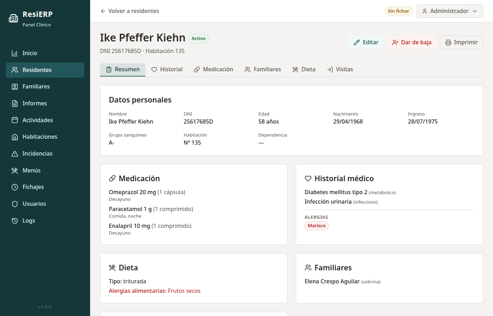
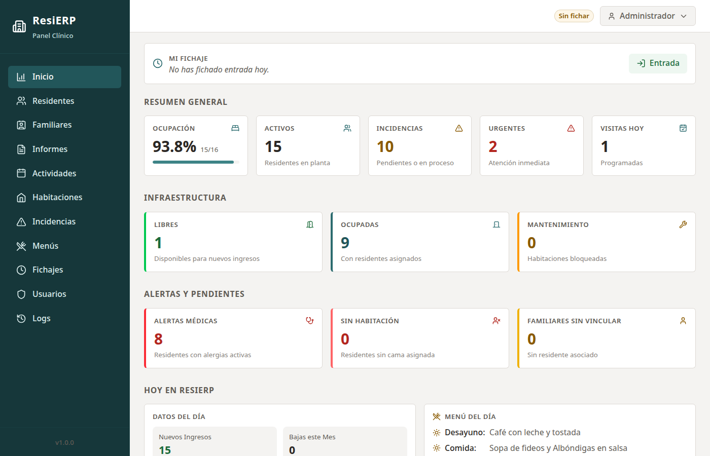
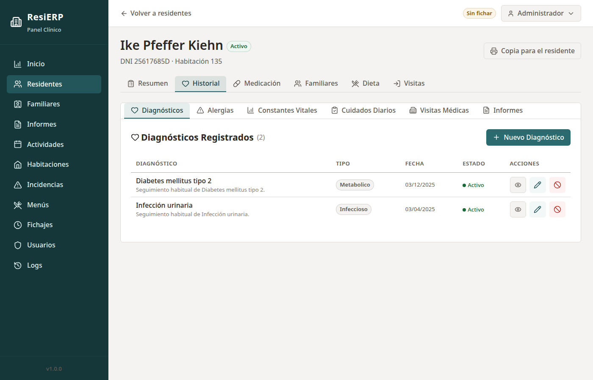
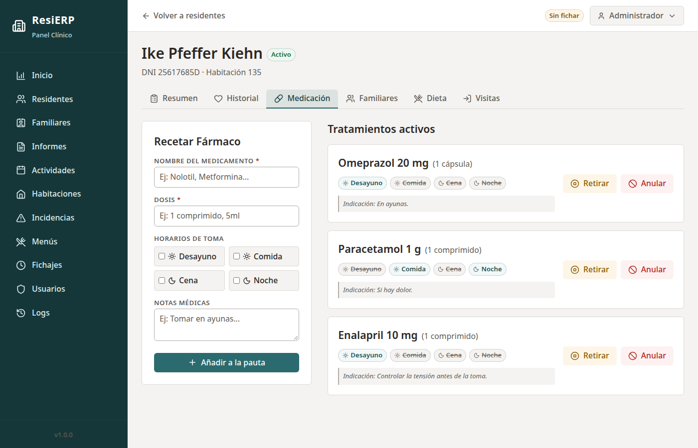
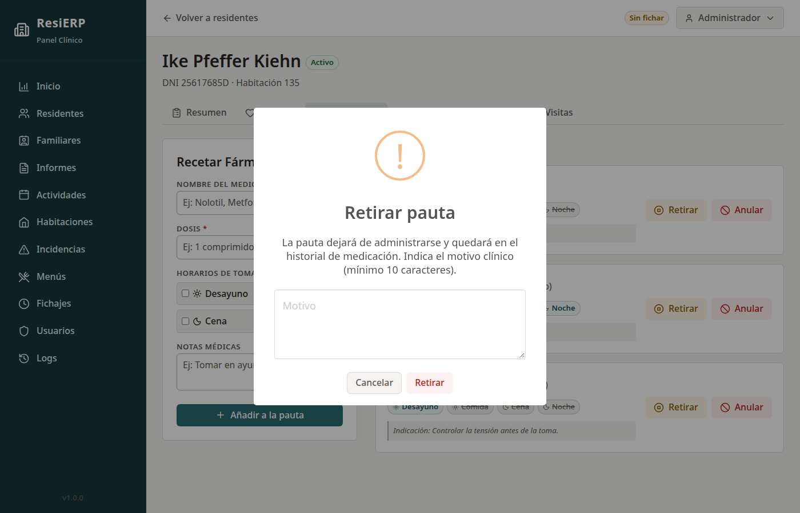
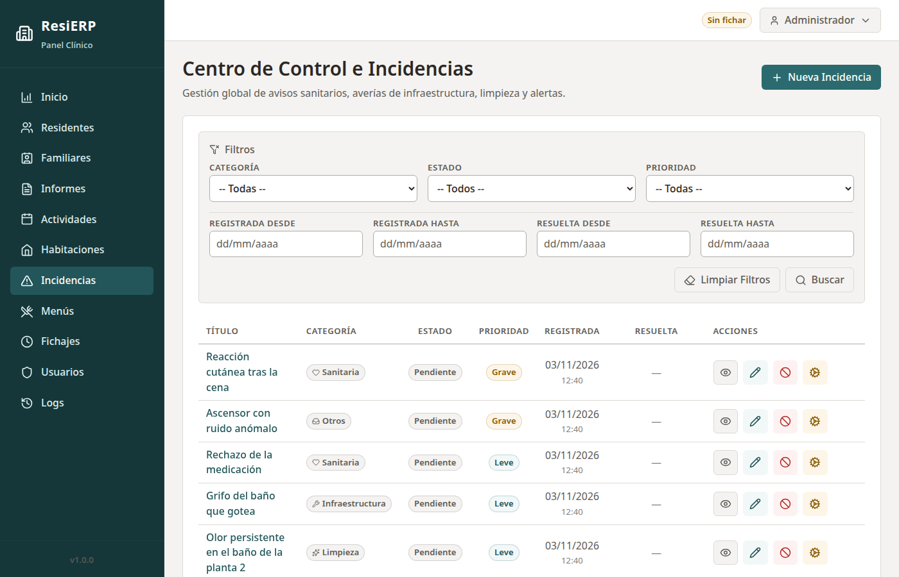
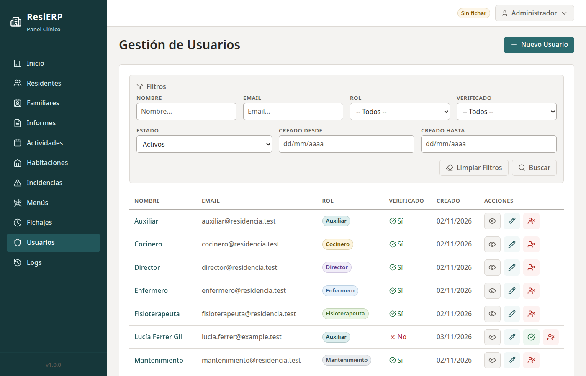
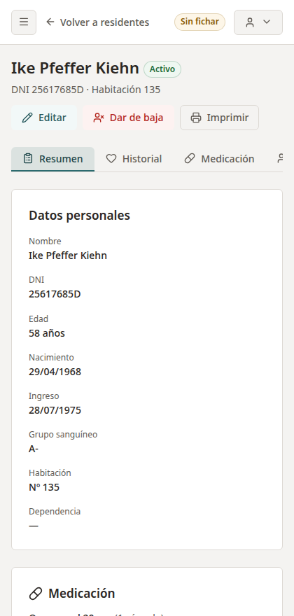
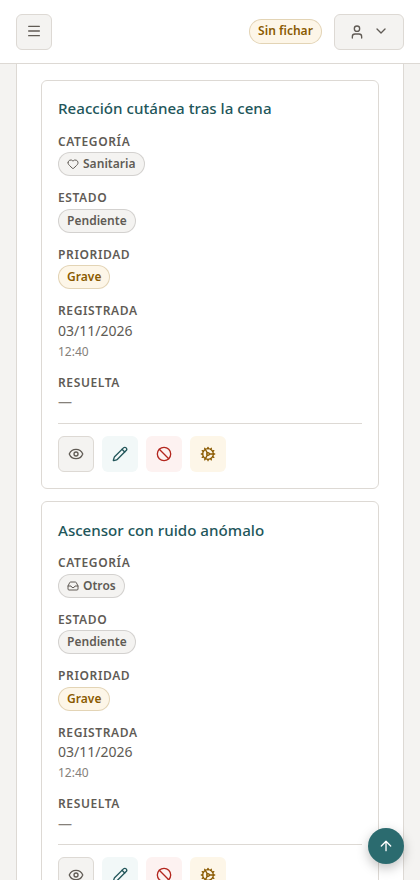

# ResiERP

Web ERP for care homes: residents, clinical records, medication, incidents, staff time tracking and visits, with nine staff roles that each have their own permissions.

Because it handles health data about vulnerable people, the focus is on security and traceability: granular permissions, clinical records that are voided rather than deleted, and audit logs that include reads of sensitive data.

> The interface is in Spanish, as it targets care homes in Spain. All data in the screenshots is invented.



## Stack

| Layer | Technology |
|---|---|
| Backend | Laravel 13, PHP 8.4.27+ |
| Database | MySQL 8.4 |
| Frontend | Blade, Tailwind CSS v4, Alpine.js, Vite |
| Auth and permissions | Laravel Breeze, spatie/laravel-permission |
| Infrastructure | Docker Compose, Nginx, PHP-FPM |
| Quality | PHPUnit, Laravel Pint, Trivy, GitHub Actions |

## Features

- **Residents:** admissions, discharges and room assignment, with a tabbed record for each person.
- **Clinical history:** diagnoses, allergies, vital signs, daily care and medical visits.
- **Medication:** active prescriptions by time of day, withdrawal with a clinical reason, and full history.
- **Reports:** by professional area, with validated PDF attachments stored privately.
- **Incidents:** healthcare, infrastructure, cleaning and staff, with status and priority.
- **Staff time tracking:** clock in and out, corrections kept as a separate record, and export.
- **Daily operations:** family contacts, visits, diets, menus, activities and rooms.
- **Users and audit log:** deactivation instead of deletion, and a searchable record of who did what.
- **Right of access:** printable copy of a resident's clinical record.

## Screenshots

| Dashboard | Clinical history |
|---|---|
|  |  |

| Medication | Reason required to withdraw or void |
|---|---|
|  |  |

| Incidents | Users and roles |
|---|---|
|  |  |

Tables become cards on small screens, at a width that depends on how many columns they have:

<p>
  
  
</p>

## Technical highlights

- **Permissions by role:** the code checks permissions, never role names, and Policies handle rules that depend on the record. A test compares the [permission matrix](docs/permisos.md) with the code.
- **Void instead of delete:** clinical records are voided with a mandatory reason, and `RESTRICT` foreign keys stop the database from cascade-deleting history.
- **Audit trail:** changes are logged automatically, and so are reads of sensitive clinical data.
- **Concurrency:** `lockForUpdate` inside a transaction stops two people from assigning the last bed at the same time.
- **Hardened containers:** multi-stage build, non-root application and web containers, and a database network with no outside access.
- **CI:** tests on SQLite and MySQL, code style, dependency audits and image scanning with Trivy.

## Getting started

You need Docker with Compose, and port 80 free.

```bash
git clone https://github.com/MrDaviidMT/ResiERP.git
cd ResiERP
cp .env.example .env
```

In `.env`, fill in `DB_PASSWORD`, `DB_ROOT_PASSWORD`, `ADMIN_PASSWORD` and `DEMO_PASSWORD` with values of your own. Then generate the application key and start the stack:

```bash
KEY=$(docker compose run --rm --no-deps --entrypoint php app artisan key:generate --show | tail -1)
sed -i "s|^APP_KEY=.*|APP_KEY=$KEY|" .env
docker compose up -d
```

Migrations run when the containers start. Once the site responds at <http://localhost>, load the data:

```bash
# Permissions, one user per job and sample residents
docker compose exec app php artisan db:seed

# Optional: invented data for every screen. It refuses to run in production
docker compose exec app php artisan db:seed --class=DemoSeeder
```

Sign in as `admin@residencia.test` with `ADMIN_PASSWORD`, or as one user per job with `DEMO_PASSWORD`, for example `enfermero@residencia.test` or `director@residencia.test`.

The session cookie is `Secure` by default, so outside `localhost` the application needs HTTPS.

### Running the tests

The application image has no development dependencies, so tests run with PHP 8.4.27 or newer, Composer and Node on the host:

```bash
composer install
npm ci && npm run build
php artisan test        # SQLite in memory
vendor/bin/pint --test  # code style
```
